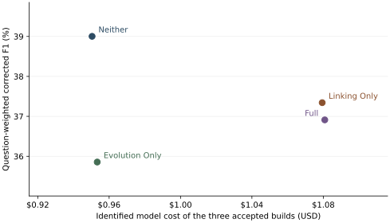

# GPT-4o-mini A-MEM ablation on 558 matched LoCoMo questions

**All twelve cells are independently accepted.** The final Linking Only / conv-44 run was Clean. One fresh local build produced 675 memories and answered all 158 questions on the first attempt, with zero retries. On the full matched population, Neither achieved **39.00% corrected F1 and 35.01% BLEU-1**, the highest scores of the four conditions. Linking Only averaged more than twice as many retrieved entries per question as Neither and scored 1.66 F1 points lower.

[558 matched question records](gpt4omini-558q-four-condition-scores.jsonl) · [All conversation and category aggregates](gpt4omini-twelve-cell-analysis.json) · [F1 and cost data](gpt4omini-f1-vs-cost.csv)

## Protocol and population

Each condition covered the same 558 original questions from conv-44 (675 turns, 158 questions), conv-49 (509 turns, 196 questions) and conv-50 (568 turns, 204 questions). The experiment crossed two action gates. Linking Only lets a new note acquire links and tags. Evolution Only lets existing neighbours acquire new context and tags. Full enables both, and Neither disables both. Every build still sent the shared evolution decision and retained the author's insertion, consolidation, counter and stale-index behaviour.

The model was `openai/gpt-4o-mini-2024-07-18` via OpenRouter with OpenAI as the sole upstream. The four native schemas and prompts were frozen. Temperature was 0.7 except for category-5 answers at 0.5. The evolution output limit was 4,096 tokens, and the remaining stages allowed 1,000. Construction used five neighbours. QA started with the top ten notes and used the author's link expansion.

The primary metrics are corrected author F1 and BLEU-1. Historical scoring applies the legacy adversarial reference to the same predictions. Binary adversarial correctness is the count correct among 121 adversarial questions. Each paired difference and the four-term interaction were calculated for each original question before taking the mean. Pooled scores weight each question equally. The category counts are 99 multi-hop, 89 temporal, 27 open-domain, 222 single-hop and 121 adversarial. Per-conversation, per-category and per-question results are linked alongside the report.

The fresh replacement was admitted under a predeclared first-completion rule. A classified failure could trigger one identical retransmission before a valid result was accepted, subject to six retries, at most three fresh attempts and a single USD 10 model-and-service ceiling. The opening campaign commitment of USD 10.138902 retained the prior service earmark and five unresolved reservations totalling USD 0.099644. The prior 231-note stop, its continuation with a complete build and 87 answers, and the 566-note replacement remain separate historical evidence.

## Results by conversation

| Conversation | Condition | Status | QA | Corrected F1 / BLEU-1 (%) | Historical F1 / BLEU-1 (%) | Adversarial correct | Identified model USD |
| --- | --- | --- | --- | --- | --- | --- | --- |
| conv-44 | Neither | Clean | 158 | 43.11 / 38.35 | 34.30 / 29.30 | 25/35 | 0.35561970 |
| conv-44 | Evolution Only | Clean | 158 | 39.15 / 34.85 | 33.77 / 29.45 | 22/35 | 0.35714685 |
| conv-44 | Linking Only | Clean | 158 | 38.71 / 34.22 | 33.27 / 28.61 | 22/35 | 0.39063510 |
| conv-44 | Full | Degraded | 158 | 39.50 / 34.52 | 38.58 / 33.70 | 18/35 | 0.39390465 |
| conv-49 | Neither | Clean | 196 | 36.19 / 31.78 | 26.87 / 22.44 | 29/40 | 0.27892170 |
| conv-49 | Evolution Only | Clean | 196 | 35.26 / 31.80 | 29.00 / 25.52 | 26/40 | 0.28014945 |
| conv-49 | Linking Only | Clean | 196 | 36.41 / 32.74 | 30.92 / 27.27 | 25/40 | 0.32385990 |
| conv-49 | Full | Clean | 196 | 35.17 / 31.40 | 32.30 / 28.49 | 22/40 | 0.31996545 |
| conv-50 | Neither | Degraded | 204 | 38.53 / 35.53 | 29.75 / 26.72 | 32/46 | 0.31590645 |
| conv-50 | Evolution Only | Clean | 204 | 33.88 / 30.77 | 26.08 / 22.94 | 31/46 | 0.31603155 |
| conv-50 | Linking Only | Clean | 204 | 37.18 / 33.88 | 27.15 / 23.94 | 33/46 | 0.36489600 |
| conv-50 | Full | Clean | 204 | 36.58 / 32.84 | 28.50 / 24.86 | 31/46 | 0.36696630 |

## Overall question-weighted scores

| Condition | Corrected F1 / BLEU-1 (%) | Historical F1 / BLEU-1 (%) | Adversarial correct |
| --- | --- | --- | --- |
| Neither | 39.00 / 35.01 | 30.03 / 25.95 | 86/121 |
| Evolution Only | 35.86 / 32.29 | 29.29 / 25.69 | 79/121 |
| Linking Only | 37.34 / 33.57 | 30.21 / 26.43 | 80/121 |
| Full | 36.91 / 32.81 | 32.69 / 28.64 | 71/121 |

## Corrected matched contrasts

| Contrast, ΔF1 / ΔBLEU-1 (pp) | conv-44 | conv-49 | conv-50 | All 558 |
| --- | --- | --- | --- | --- |
| Linking − Neither | -4.40 / -4.13 | 0.22 / 0.95 | -1.35 / -1.65 | -1.66 / -1.44 |
| Evolution − Neither | -3.96 / -3.50 | -0.93 / 0.02 | -4.65 / -4.76 | -3.15 / -2.72 |
| Full − Linking | 0.79 / 0.31 | -1.23 / -1.34 | -0.60 / -1.04 | -0.43 / -0.76 |
| Full − Evolution | 0.35 / -0.33 | -0.09 / -0.40 | 2.70 / 2.07 | 1.06 / 0.52 |
| Interaction | 4.75 / 3.80 | -0.31 / -1.36 | 4.05 / 3.72 | 2.72 / 1.96 |

### Category scores (%)

| Category | QA | Neither | Evolution Only | Linking Only | Full |
| --- | --- | --- | --- | --- | --- |
| Multi-hop | 99 | 16.86 / 11.94 | 15.72 / 10.54 | 20.25 / 15.00 | 17.54 / 11.29 |
| Temporal | 89 | 36.61 / 32.80 | 34.17 / 31.27 | 31.62 / 28.32 | 34.29 / 30.13 |
| Open-domain | 27 | 14.37 / 14.15 | 8.09 / 7.88 | 12.78 / 12.86 | 15.92 / 16.41 |
| Single-hop | 222 | 34.82 / 28.72 | 32.18 / 26.90 | 33.75 / 28.18 | 35.94 / 30.40 |
| Adversarial | 121 | 72.05 / 71.70 | 66.51 / 66.15 | 67.61 / 67.15 | 61.16 / 60.48 |

### Category contrasts (pp)

| Category | Linking − Neither | Evolution − Neither | Full − Linking | Full − Evolution | Interaction |
| --- | --- | --- | --- | --- | --- |
| Multi-hop | 3.40 / 3.06 | -1.14 / -1.40 | -2.71 / -3.71 | 1.83 / 0.75 | -1.57 / -2.30 |
| Temporal | -4.99 / -4.48 | -2.44 / -1.53 | 2.67 / 1.81 | 0.12 / -1.15 | 5.11 / 3.33 |
| Open-domain | -1.59 / -1.29 | -6.28 / -6.27 | 3.13 / 3.55 | 7.83 / 8.53 | 9.41 / 9.82 |
| Single-hop | -1.07 / -0.54 | -2.64 / -1.82 | 2.19 / 2.22 | 3.75 / 3.50 | 4.82 / 4.04 |
| Adversarial | -4.45 / -4.55 | -5.55 / -5.55 | -6.45 / -6.67 | -5.35 / -5.67 | -0.90 / -1.12 |

## Historical matched contrasts

| Contrast, ΔF1 / ΔBLEU-1 (pp) | conv-44 | conv-49 | conv-50 | All 558 |
| --- | --- | --- | --- | --- |
| Linking − Neither | -1.02 / -0.69 | 4.05 / 4.83 | -2.61 / -2.78 | 0.18 / 0.49 |
| Evolution − Neither | -0.52 / 0.15 | 2.13 / 3.07 | -3.67 / -3.78 | -0.74 / -0.26 |
| Full − Linking | 5.31 / 5.09 | 1.38 / 1.22 | 1.36 / 0.92 | 2.49 / 2.21 |
| Full − Evolution | 4.81 / 4.26 | 3.30 / 2.98 | 2.42 / 1.92 | 3.40 / 2.95 |
| Interaction | 5.84 / 4.94 | -0.75 / -1.85 | 5.03 / 4.70 | 3.23 / 2.47 |

### Category scores (%)

| Category | QA | Neither | Evolution Only | Linking Only | Full |
| --- | --- | --- | --- | --- | --- |
| Multi-hop | 99 | 16.86 / 11.94 | 15.72 / 10.54 | 20.25 / 15.00 | 17.54 / 11.29 |
| Temporal | 89 | 36.61 / 32.80 | 34.17 / 31.27 | 31.62 / 28.32 | 34.29 / 30.13 |
| Open-domain | 27 | 14.37 / 14.15 | 8.09 / 7.88 | 12.78 / 12.86 | 15.92 / 16.41 |
| Single-hop | 222 | 34.82 / 28.72 | 32.18 / 26.90 | 33.75 / 28.18 | 35.94 / 30.40 |
| Adversarial | 121 | 30.66 / 29.90 | 36.21 / 35.71 | 34.70 / 34.22 | 41.70 / 41.24 |

### Category contrasts (pp)

| Category | Linking − Neither | Evolution − Neither | Full − Linking | Full − Evolution | Interaction |
| --- | --- | --- | --- | --- | --- |
| Multi-hop | 3.40 / 3.06 | -1.14 / -1.40 | -2.71 / -3.71 | 1.83 / 0.75 | -1.57 / -2.30 |
| Temporal | -4.99 / -4.48 | -2.44 / -1.53 | 2.67 / 1.81 | 0.12 / -1.15 | 5.11 / 3.33 |
| Open-domain | -1.59 / -1.29 | -6.28 / -6.27 | 3.13 / 3.55 | 7.83 / 8.53 | 9.41 / 9.82 |
| Single-hop | -1.07 / -0.54 | -2.64 / -1.82 | 2.19 / 2.22 | 3.75 / 3.50 | 4.82 / 4.04 |
| Adversarial | 4.03 / 4.32 | 5.55 / 5.81 | 7.00 / 7.02 | 5.49 / 5.53 | 1.45 / 1.22 |

## Retrieval, memory actions and cost

| Condition | Strengthen | Neighbour updates | Mean retrieved entries | Native answer input tokens | Selected model cost (USD) | Corrected F1 (%) |
| --- | --- | --- | --- | --- | --- | --- |
| Neither | 0 | 0 | 10.00 | 747,640 | 0.95044785 | 39.00 |
| Evolution Only | 0 | 589 | 10.00 | 749,026 | 0.95332785 | 35.86 |
| Linking Only | 1718 | 0 | 20.15 | 1,511,478 | 1.07939100 | 37.34 |
| Full | 1722 | 583 | 19.99 | 1,503,791 | 1.08083640 | 36.91 |

## Interpretation

Strengthening in isolation improved corrected F1 on conv-49 by 0.22 points and reduced it on conv-44 and conv-50 by 4.40 and 1.35. Its clearest pooled benefit was multi-hop reasoning (+3.40 F1 and +3.06 BLEU-1). Across all 558 questions, its average retrieval expanded from 10.00 to 20.15 entries. Native answer input tokens increased from 747,640 to 1,511,478, while identified model cost rose from USD 0.95045 to USD 1.07939. The additional context accompanied lower pooled scores on both primary metrics.

Evolution Only, the added fourth condition, had lower corrected F1 than Neither on each conversation and in all five pooled categories. On temporal questions, adding neighbour updates without strengthening reduced F1 by 2.44 points. With strengthening enabled, adding them increased temporal F1 by 2.67 points. Binary adversarial correctness fell from 86 to 79 out of 121 without strengthening and from 80 to 71 with strengthening. Across the 89 pooled temporal questions, the positive neighbour-update contrast occurred only with strengthening enabled. On conv-49 alone, Evolution Only exceeded Neither on temporal questions by 5.58 F1 and 8.08 BLEU-1 points.

Full exceeded Linking Only on conv-44 (+0.79 F1) and scored lower on conv-49 and conv-50 (−1.23 and −0.60). The pooled interaction of **+2.72 F1 / +1.96 BLEU-1 points** measures how the neighbour-update contrast changes when strengthening is enabled. For F1 that contrast moved from −3.15 points without strengthening to −0.43 with strengthening. The negative conv-49 interaction reversed on both other conversations. The largest positive category interaction was open-domain (+9.41 / +9.82), which accounts for just 27 questions. Single-hop accounts for 222 questions and had a +4.82 / +4.04 interaction. Multi-hop and adversarial interactions were negative on both metrics. On the 437 non-adversarial questions, Full exceeded Linking Only by 1.24 F1 and 0.87 BLEU-1 points. Once all 121 adversarial questions were included, Full scored 0.43 F1 and 0.76 BLEU-1 points below Linking Only.

Historical scores put Full first overall. That scoring policy uses a different reference for adversarial questions. Full scored 71/121 on binary adversarial correctness, the lowest count across these builds. The separate binary count helps interpret the ranking change between the historical and corrected overlap metrics.

A-MEM Table 3 reports higher F1 and BLEU-1 in the order Neither, Linking Only, Full across all five categories. None of the five pooled categories here followed that full ordering on either corrected metric. The paper describes a larger evaluation population, and its Table 8 reports GPT-4o-mini retrieval depths of 40–50 by category. The exact Table 3 question IDs and retrieval depths are unspecified. This study uses 558 preselected questions and a fixed initial depth of ten. Evolution Only has no published Table 3 counterpart. [A-MEM Table 3](https://arxiv.org/html/2502.12110v11#S4.T3) · [Table 8](https://arxiv.org/html/2502.12110v11#A1.T8)

The contrast signs describe one stochastic build per condition and conversation. Questions within a conversation share the same constructed store. Matching question IDs controls the evaluation population, while build randomness, answer randomness and collection time can all contribute to the observed differences. The three-conversation comparison supports reporting variation across conversations. It supplies no estimate of run-to-run variance or statistical significance.

## Actions and retrieval by cell

| Conversation | Condition | Strengthening actions | Neighbour updates | Mean retrieved entries per QA | Answer input tokens |
|---|---|---:|---:|---:|---:|
| conv-44 | Neither | 0 | 0 | 10.00 | 219,812 |
| conv-44 | Evolution Only | 0 | 235 | 10.00 | 218,699 |
| conv-44 | Linking Only | 658 | 0 | 20.16 | 441,319 |
| conv-44 | Full | 665 | 227 | 19.96 | 444,195 |
| conv-49 | Neither | 0 | 0 | 10.00 | 252,355 |
| conv-49 | Evolution Only | 0 | 175 | 10.00 | 252,619 |
| conv-49 | Linking Only | 497 | 0 | 20.13 | 511,652 |
| conv-49 | Full | 495 | 178 | 19.93 | 500,782 |
| conv-50 | Neither | 0 | 0 | 10.00 | 275,473 |
| conv-50 | Evolution Only | 0 | 179 | 10.00 | 277,708 |
| conv-50 | Linking Only | 563 | 0 | 20.15 | 558,507 |
| conv-50 | Full | 562 | 178 | 20.08 | 558,814 |

## Final cell verification

The paid source was `268f39514610eac1c132bd673e4d0c2094af5624`. Before release, 267 offline regression tests passed. Two full-size native simulations separately exercised a response-less disconnect and a billed provider error on QA 87. Each completed the same ordered 675 turns and 158 questions after one identical retransmission. Independent Standards and Spec reviews approved the fixed source. The real run started at 09:38 Hong Kong time on 8 November and saved its last answer at approximately 12:23. Only `gpt4omini-linking_only-conv44-final-r1` ran, from empty memory, cache and index.

All 675 metadata responses, 675 shared decisions, 158 keyword generations and 158 answers succeeded on the first physical request. The final counter was 675. There were 658 strengthening actions and zero neighbour changes. Independent replay checked the committed note fields, original word-for-word QA requests, seeded adversarial options, stale retrieval index, all 675 × 384 embedding values and all 158 top-ten rankings. Each of the two score views reproduces from the same saved predictions. The new cell contributes all 158 Linking Only / conv-44 predictions in the matched dataset.

Langfuse verified 3,476 runtime observations across 836 traces. The first Experiment visibility check reported a missing, duplicated or unexpected identifier. The bounded readback subsequently verified 316 items, 4,494 exact score values, metric names, references and subjects, and all 158 original QA trace associations. The visibility check repeated only the remote read. The two Experiment links appear in the inventory below.

## Spending and retained evidence

| Financial measure | USD |
|---|---:|
| New identified OpenRouter charges, exactly matched by wallet and key | 0.39063510 |
| New conservative model exposure | 0.391435 |
| New Langfuse service upper bound, 9,754 units at full marginal rate | 0.780320 |
| New model and metered service exposure | **1.171755** |
| New commitment with full USD 1.08 Langfuse earmark | 1.471435 |
| Campaign identified model charges | 4.69823805 |
| Campaign conservative model exposure, including five held reservations | 4.808497 |
| Campaign service upper bound using metered usage and retained allowance | 5.648560 |
| Combined campaign exposure using metered service | **10.457057** |
| Remaining USD 42 planned allocation on that basis | **31.542943** |
| Campaign commitment with full retained service earmarks | 11.610337 |
| Planned headroom after full earmarks | 30.389663 |
| Closing OpenRouter wallet / key allowance | 45.29011095 / 45.30176195 |

The USD 8 contingency remains protected. The cumulative model total includes 21,143 known billing IDs and five historical unresolved attempts reserved at USD 0.099644. The final 1,666 IDs matched the original response IDs, OpenAI route, native tokens and prices. Wallet and key each moved by USD 0.39063510, with zero unexplained movement. At 04:27 UTC on 8 November the Langfuse account showed USD 3.92 in draft usage plus its existing USD 29 subscription and zero paid usage displayed for that period. The service upper bound and the actual invoice describe different quantities. The cost comparison across conditions includes only model charges on the twelve accepted scientific builds. The programme totals include the earlier failed attempts and compatibility work.

Historical scientific, billing and observability evidence passed the preservation check, including 154,085 previously protected entries, 3,442 entries for the preceding replacement and 1,534 DeepSeek files. The two historical Degraded classifications in the accepted inventory concern conv-44 Full's compatibility lineage and the narrow two-value BLEU-4 readback exception for Neither / conv-50. All twelve accepted scientific builds recorded zero provider-generation failures. The five old billing holds belong to historical activity outside these accepted scientific requests. [Original stop](gpt4omini-linking44-transport-stop.md) · [QA-stage stop](gpt4omini-linking44-qa-stop.md) · [Earlier replacement stop](gpt4omini-linking44-replacement-stop.md)

## Langfuse Experiments

| Conversation | Condition | Corrected | Historical |
| --- | --- | --- | --- |
| conv-44 | Neither | [Experiment](https://cloud.langfuse.com/project/cmvxd2aby005wad0ei7wt2d5o/experiments/results?baseline=9bbb08d6e8dbec66) | [Experiment](https://cloud.langfuse.com/project/cmvxd2aby005wad0ei7wt2d5o/experiments/results?baseline=c9cdb85f0e917bd8) |
| conv-44 | Evolution Only | [Experiment](https://cloud.langfuse.com/project/cmvxd2aby005wad0ei7wt2d5o/experiments/results?baseline=877089259f1d95e1) | [Experiment](https://cloud.langfuse.com/project/cmvxd2aby005wad0ei7wt2d5o/experiments/results?baseline=6374428c15b01ed1) |
| conv-44 | Linking Only | [Experiment](https://cloud.langfuse.com/project/cmvxd2aby005wad0ei7wt2d5o/experiments/results?baseline=d7c39e2e54eea178) | [Experiment](https://cloud.langfuse.com/project/cmvxd2aby005wad0ei7wt2d5o/experiments/results?baseline=c783ee277510158f) |
| conv-44 | Full | [Experiment](https://cloud.langfuse.com/project/cmvxd2aby005wad0ei7wt2d5o/experiments/results?baseline=b4a39a3e02e2f361) | [Experiment](https://cloud.langfuse.com/project/cmvxd2aby005wad0ei7wt2d5o/experiments/results?baseline=bd8af7375fe2248e) |
| conv-49 | Neither | [Experiment](https://cloud.langfuse.com/project/cmvxd2aby005wad0ei7wt2d5o/experiments/results?baseline=ffb8015ce0c3a1fb) | [Experiment](https://cloud.langfuse.com/project/cmvxd2aby005wad0ei7wt2d5o/experiments/results?baseline=210a29a1178dde3d) |
| conv-49 | Evolution Only | [Experiment](https://cloud.langfuse.com/project/cmvxd2aby005wad0ei7wt2d5o/experiments/results?baseline=08a0e6f298cd60be) | [Experiment](https://cloud.langfuse.com/project/cmvxd2aby005wad0ei7wt2d5o/experiments/results?baseline=1482f918f8de0a32) |
| conv-49 | Linking Only | [Experiment](https://cloud.langfuse.com/project/cmvxd2aby005wad0ei7wt2d5o/experiments/results?baseline=3e0ff28564f58b74) | [Experiment](https://cloud.langfuse.com/project/cmvxd2aby005wad0ei7wt2d5o/experiments/results?baseline=a8f94a670e20e9e7) |
| conv-49 | Full | [Experiment](https://cloud.langfuse.com/project/cmvxd2aby005wad0ei7wt2d5o/experiments/results?baseline=548dc7ac3e4313b8) | [Experiment](https://cloud.langfuse.com/project/cmvxd2aby005wad0ei7wt2d5o/experiments/results?baseline=20e5a01c0f078a2b) |
| conv-50 | Neither | [Experiment](https://cloud.langfuse.com/project/cmvxd2aby005wad0ei7wt2d5o/experiments/results?baseline=adc0d9055c4d79ec) | [Experiment](https://cloud.langfuse.com/project/cmvxd2aby005wad0ei7wt2d5o/experiments/results?baseline=fc26ec074fa15cf0) |
| conv-50 | Evolution Only | [Experiment](https://cloud.langfuse.com/project/cmvxd2aby005wad0ei7wt2d5o/experiments/results?baseline=946a968c94ade465) | [Experiment](https://cloud.langfuse.com/project/cmvxd2aby005wad0ei7wt2d5o/experiments/results?baseline=8e18ba9b4c3bdaf1) |
| conv-50 | Linking Only | [Experiment](https://cloud.langfuse.com/project/cmvxd2aby005wad0ei7wt2d5o/experiments/results?baseline=3267f9cb9f6d61eb) | [Experiment](https://cloud.langfuse.com/project/cmvxd2aby005wad0ei7wt2d5o/experiments/results?baseline=b02e293fd2a9f1c5) |
| conv-50 | Full | [Experiment](https://cloud.langfuse.com/project/cmvxd2aby005wad0ei7wt2d5o/experiments/results?baseline=d10820173a73dd38) | [Experiment](https://cloud.langfuse.com/project/cmvxd2aby005wad0ei7wt2d5o/experiments/results?baseline=c7db7b64fd2f6807) |

## Verification receipts

Local receipts under `artifacts/gpt4omini/` are identified by their SHA-256 digests. Two independent calculations agreed exactly on all 558 published question records, all 864 group means and paired differences, the binary counts and the identified model costs.

| Evidence | SHA-256 |
|---|---|
| Group release | `a032b13141c915c224a9e99c61e0187b3cadce27c087209240ec705060e8a580` |
| Reviewed-source Standards | `758d5642237a5fc4a57553af1aa4c3a160d143a749bb22ecb508ebe417414cc9` |
| Reviewed-source Spec | `23eda9182eb98104ccb44468cf56d3b294a087cf0275ecec09bae56ed8b29e38` |
| Final phase file | `eef21eb605c24075a2ec7e90bd255ed86509f49eb3f10f595f9f0acf25832fb5` |
| Final scientific memory | `9f5044415d0c14b52cadf510e42724e20a46917692857ad2dbf2e81f0e42ceb8` |
| Scoring views | `cb5a67bba20b78942b446acce9ed87501d47a7183de0f3f5a151b2d31e39aa06` |
| Provider close | `bd636e3817bf94c5e82ef46226b6f4f4f38cab5b1eb92a8617c395251fa65f4c` |
| Clean Standards acceptance | `a89749e0d35481a1d61068499a527d4b2acc4affd9f0bb6cde78609f4bdf1171` |
| Clean Spec acceptance | `d564e8042c73d6b052bad5013bdc0fcb251db2ce755f32663b61b87de9c17ae6` |
| Independent programme close | `7cda748a00123f653b8487a9113ae63de8bcb23b13e88ad7f3e36b6fda2e9b20` |
| Independent matched analysis | `d7646ff8be1d5431e141528b53be6bc0483cd38b16d92337a1024b44841697c3` |
